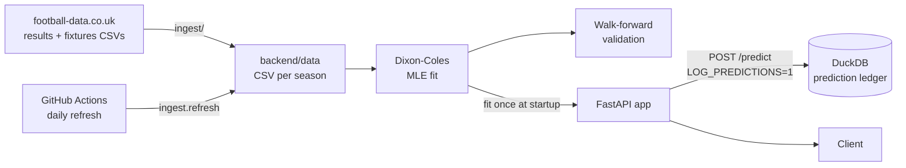

# Soccer Predictor

A match-outcome prediction service for the English Premier League. It fits a **Dixon-Coles** model to five seasons of results, validates it with **walk-forward backtesting**, serves predictions through a **FastAPI** app, and can record every prediction in a **hash-chained, tamper-evident ledger** in DuckDB. A GitHub Actions job refreshes results and fixtures daily.

**Live API:** https://soccer-predictor-dy7l.onrender.com (interactive docs at [`/docs`](https://soccer-predictor-dy7l.onrender.com/docs))

> The premise: a sports model is only credible if it is validated honestly and its predictions are auditable. The model, the validation, and the ledger are the product.

---

## Table of Contents

- [Highlights](#highlights)
- [Architecture](#architecture)
- [The Model](#the-model)
- [Validation](#validation)
- [Results](#results)
- [Feature Engineering](#feature-engineering)
- [Prediction Ledger](#prediction-ledger)
- [Automated Data Refresh](#automated-data-refresh)
- [API Reference](#api-reference)
- [Getting Started](#getting-started)
- [Testing](#testing)
- [Project Structure](#project-structure)
- [Design Decisions](#design-decisions)
- [Limitations](#limitations)
- [Data Attribution](#data-attribution)

---

## Highlights

- **Dixon-Coles model** with attack/defense ratings, home advantage, exponential time-decay weighting, the low-score (rho) correction, and identifiability constraints.
- **Vectorized maximum-likelihood fit** (SciPy L-BFGS-B over batch NumPy operations), fast enough to refit at every walk-forward cutoff.
- **Walk-forward validation** that only predicts matches the model has not seen, reporting accuracy, log loss, Brier score, and per-class (home/draw/away) accuracy.
- **Hash-chained prediction ledger** on DuckDB with a `verify_chain` check that detects any retroactive edit.
- **Fit once, serve many.** The model is fit at startup in the FastAPI lifespan and cached on `app.state`.
- **Daily data refresh** via GitHub Actions: pulls the current season's results and upcoming fixtures and commits them if they changed, keeping the last good data if a download looks wrong.
- **53 pytest tests** run offline against synthetic data.

---

## Architecture



| Layer | Module | Responsibility |
|---|---|---|
| Ingestion | `ingest/` | Downloads EPL results (one CSV per season) and upcoming fixtures |
| Model | `models/dixon_coles.py` | Dixon-Coles MLE fit; expected goals, 1X2 probabilities, top scorelines |
| Validation | `validation/walk_forward.py` | Rolling-origin backtest with proper scoring rules |
| Features | `features/` | Leakage-free form, home/away form, and Elo features |
| API | `main.py`, `fixture_list.py` | Predictions, team list, upcoming fixtures |
| Ledger | `ledger/prediction_ledger.py` | Append-only, hash-chained record of predictions |

---

## The Model

Follows Dixon & Coles (1997). Each team `i` has an attack strength `α_i` and a defense weakness `β_i`; the home side gets a shared home-advantage factor `γ`:

```
λ (home goals) = α_i · β_j · γ
μ (away goals) = α_j · β_i
```

Goals are Poisson, with the correction `τ` applied to the low-score cells (0-0, 1-0, 0-1, 1-1), where independent Poisson is miscalibrated:

```
P(X = x, Y = y) = τ(x, y; λ, μ, ρ) · Pois(x; λ) · Pois(y; μ)
```

Win/draw/loss probabilities and the most likely scorelines come from the resulting score grid (up to 10 goals per side).

| Component | Purpose |
|---|---|
| **Time decay** | Each match is weighted by `exp(-ξ · days_ago)` with `ξ = 0.0018` (the paper's default), so recent form counts more. |
| **Rho correction** | Adjusts the four low-score cells. |
| **Identifiability constraint** | Attack ratings are normalized to a mean of 1 so the optimizer converges to a stable solution. |
| **Vectorized likelihood** | Team indices and goal arrays are built once outside the objective; the likelihood runs as array ops. |

---

## Validation

Random train/test splits leak the future into the past, so validation is **walk-forward (rolling-origin)**:

1. Fit on all matches before a cutoff.
2. Predict the matches in the next window (default 30 days).
3. Score against actual results.
4. Advance the cutoff and repeat.

`run_walk_forward` returns one row per window plus an `AGGREGATE` row (mean across windows), so two model versions can be compared directly.

| Metric | Why it's tracked |
|---|---|
| **Accuracy** | Easy to read, but ignores confidence, so never used alone |
| **Log loss** | Proper scoring rule; punishes confident wrong predictions |
| **Brier score** | Proper scoring rule; squared probability error, averaged over the three classes |
| **Per-class accuracy** | Home, draw, and away reported separately; draws are the hardest class |

---

## Results

| Predictor | Accuracy | Log loss | Brier |
|---|---|---|---|
| Uniform guess (⅓ / ⅓ / ⅓) | 33.3% | 1.0986 | 0.2222 |
| Always pick the home team | 44.0% | — | — |
| **Dixon-Coles (walk-forward)** | **53.2%** | **0.9933** | **0.1949** |

Measured on 2022/23 – 2026/27 data (1,590 matches through 2026-10-19): 39 monthly cutoffs, 180 days minimum training history, 1,376 matches scored and 15 skipped because a promoted team had no history yet. The home-team baseline uses the same 1,376 matches.

Per class, the model calls 77% of home wins and 60% of away wins correctly, but under 1% of draws, because a draw is rarely the single most likely outcome. Draw probabilities still count toward log loss and Brier.

To reproduce (from `backend/`):

```bash
python -c "import pandas as pd; from pathlib import Path; from validation.walk_forward import load_matches, run_walk_forward; m = pd.concat([load_matches(p) for p in sorted(Path('data/raw').glob('E0_*.csv'))]).sort_values('Date').reset_index(drop=True); print(run_walk_forward(m).tail(1).T)"
```

Numbers shift slightly as the daily refresh adds new matches.

---

## Feature Engineering

Built under one rule: **every feature uses only information available before kickoff.**

| Feature group | Module | Description |
|---|---|---|
| **Team form** | `features/team_form.py` | Rolling-window goals scored, conceded, and points |
| **Home/away split form** | `features/home_away_form.py` | Home team's form from only its past home matches; away team's from only its away matches |
| **Elo rating** | `features/elo.py` | Sequential pre-match ratings with home advantage and a goal-difference multiplier |

These modules are implemented and tested, but the served Dixon-Coles model does not consume them; it fits on scores only. They are the inputs for a possible stacked model (see [Design Decisions](#design-decisions)).

---

## Prediction Ledger

When `LOG_PREDICTIONS=1`, every `/predict` call appends one row to a DuckDB table (`predictions.duckdb`):

| Column | Description |
|---|---|
| `prediction_id` | Unique ID, returned to the caller |
| `match_id` | `<home>_vs_<away>_<date>` |
| `home_team`, `away_team` | Teams |
| `model_version` | e.g. `dixon_coles_v1` |
| `predicted_at` | Timestamp, stored as `VARCHAR` so the hashed bytes round-trip exactly |
| `home_win_prob`, `draw_prob`, `away_win_prob` | Predicted probabilities |
| `actual_result` | Nullable; set later with `record_actual_result` |
| `record_hash` | SHA-256 of the record's fields **plus the previous record's hash** |

Because each hash depends on the one before it, editing or deleting a historical row breaks every hash after it. `verify_chain(db_path)` walks the chain and returns `{"valid": True, "records_checked": n}` or the first broken record. `record_actual_result` fills in outcomes without breaking the chain.

Logging is **off by default**: Render's disk is wiped on every redeploy, and anonymous visitors shouldn't be adding rows to the chain. Recording results and verifying the chain are done from Python; neither is exposed as an API endpoint.

---

## Automated Data Refresh

`.github/workflows/refresh-data.yml` runs daily at 06:17 UTC (and on demand). It runs `python -m ingest.refresh`, which re-downloads only the current season plus the fixtures file, validates required columns, and keeps the existing file if a download looks wrong. Changed data is committed back to the repo, and the API refits on its next startup.

---

## API Reference

### `GET /health`

```json
{ "status": "ok", "data_through": "2026-10-25" }
```

`data_through` is the date of the latest match in the training data.

### `GET /teams`

Teams in the current season. Use these exact names in `/predict`.

### `GET /fixtures/upcoming?days=14`

Upcoming EPL fixtures in the next `days` days (1–60, default 14). Each fixture has a `predictable` flag that is false when a team has no history in the data.

### `POST /predict`

```bash
curl -X POST https://soccer-predictor-dy7l.onrender.com/predict \
  -H "Content-Type: application/json" \
  -d '{"home_team": "Arsenal", "away_team": "Chelsea"}'
```

Response shape:

```json
{
  "prediction_id": null,
  "home_team": "Arsenal",
  "away_team": "Chelsea",
  "home_win_prob": 0.52,
  "draw_prob": 0.25,
  "away_win_prob": 0.23,
  "home_expected_goals": 1.68,
  "away_expected_goals": 1.02,
  "top_scorelines": [
    { "home_goals": 1, "away_goals": 0, "prob": 0.12 },
    { "home_goals": 1, "away_goals": 1, "prob": 0.11 },
    { "home_goals": 2, "away_goals": 1, "prob": 0.09 }
  ],
  "model_version": "dixon_coles_v1"
}
```

`prediction_id` is set only when `LOG_PREDICTIONS=1`.

| Status | Cause |
|---|---|
| `404` | Unknown team name (see `/teams`) |
| `400` | `home_team` and `away_team` are the same |

---

## Getting Started

Requires Python 3.11+. All commands run from `backend/`, since paths like `data/raw` are relative to it.

```bash
git clone https://github.com/dgoumtsop/Soccer-Predictor.git
cd Soccer-Predictor/backend

python -m venv .venv
source .venv/bin/activate        # Windows: .venv\Scripts\activate
pip install -r requirements.txt
```

Match data is committed in `data/`. To re-download it:

```bash
python -m ingest.fetch_data       # all five seasons -> data/raw/E0_<season>.csv
python -m ingest.fetch_fixtures   # upcoming fixtures -> data/fixtures/E0.csv
```

Run the API:

```bash
uvicorn main:app --reload
```

The model fits during startup, then the docs are at http://127.0.0.1:8000/docs.

| Environment variable | Default | Effect |
|---|---|---|
| `LOG_PREDICTIONS` | `0` | Set to `1` to write each prediction to `predictions.duckdb` |

---

## Testing

```bash
pytest
```

53 tests, all offline on synthetic data. They cover the model (valid probabilities, time decay, attack normalization, scoreline ordering), walk-forward cutoffs and aggregation, each feature module (including checks that no future match leaks in), the ledger (chain validity, result recording, tamper detection), ingestion and refresh fallbacks, and the API (`/health`, `/teams`, `/fixtures/upcoming`, `/predict`, ledger writes, and the 404/400 cases).

---

## Project Structure

```
Soccer-Predictor/
├── .github/workflows/refresh-data.yml   # daily data refresh
└── backend/
    ├── main.py                  # FastAPI app and endpoints
    ├── fixture_list.py          # loads and filters upcoming fixtures
    ├── requirements.txt
    ├── data/
    │   ├── raw/                 # E0_<season>.csv results
    │   └── fixtures/E0.csv      # upcoming fixtures
    ├── ingest/
    │   ├── fetch_data.py        # download all seasons
    │   ├── fetch_fixtures.py    # download fixtures
    │   └── refresh.py           # daily refresh entry point
    ├── models/dixon_coles.py    # the model
    ├── validation/walk_forward.py
    ├── features/                # team_form, home_away_form, elo
    ├── ledger/prediction_ledger.py
    └── tests/
```

---

## Design Decisions

| Decision | Rationale |
|---|---|
| **Fit once at startup** | Refitting per request means re-running the optimizer on every call. The data only changes on refresh, so the model is fit in the lifespan and cached. |
| **Validate before improving** | Walk-forward validation was built before the model upgrades, so every change was measured against a baseline. |
| **Hash-chained ledger** | Makes the prediction history tamper-evident, which is the core of the project's credibility. |
| **Ledger off in production** | An ephemeral disk and public traffic would make the chain meaningless; it is enabled only for deliberate runs. |
| **Defensive refresh** | A bad download keeps the last good file, so a refresh can never break a working deploy. |
| **Stacking, not replacement** | If a gradient-boosted model is ever added, Dixon-Coles expected goals and the engineered features become its inputs, and it ships only if it beats plain Dixon-Coles on walk-forward validation. |

---

## Limitations

- **Results-only data.** No expected goals, lineups, injuries, or transfers, all of which move real probabilities.
- **Draws are hard.** The model almost never picks a draw as the top outcome.
- **One league.** Promoted teams have little or no history; fixtures involving a team with none are flagged as not predictable.
- **Not betting advice.** This is an engineering and statistics project, with no claim to beat bookmaker lines.

---

## Data Attribution

Match data comes from [football-data.co.uk](https://www.football-data.co.uk/). Please respect their terms of use.

## References

- Dixon, M. J. & Coles, S. G. (1997). *Modelling Association Football Scores and Inefficiencies in the Football Betting Market.* Journal of the Royal Statistical Society: Series C, 46(2), 265–280.
